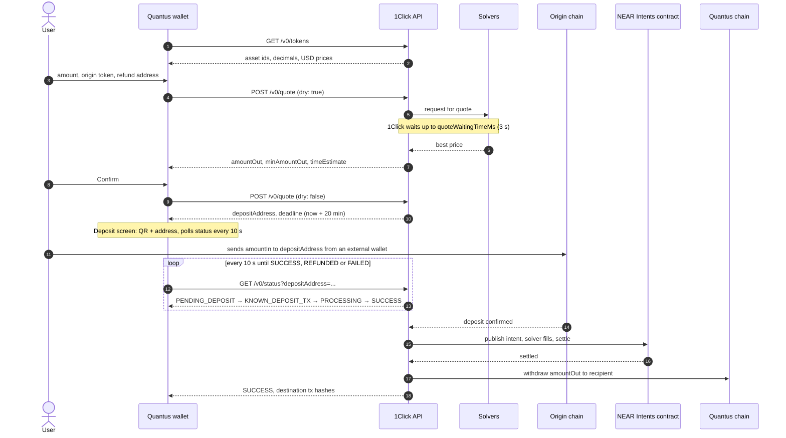
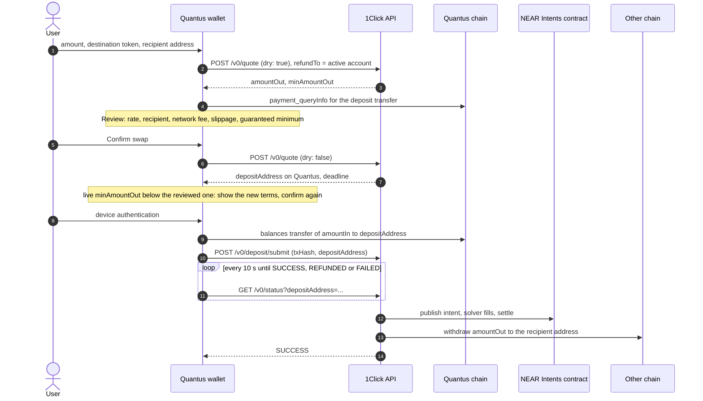
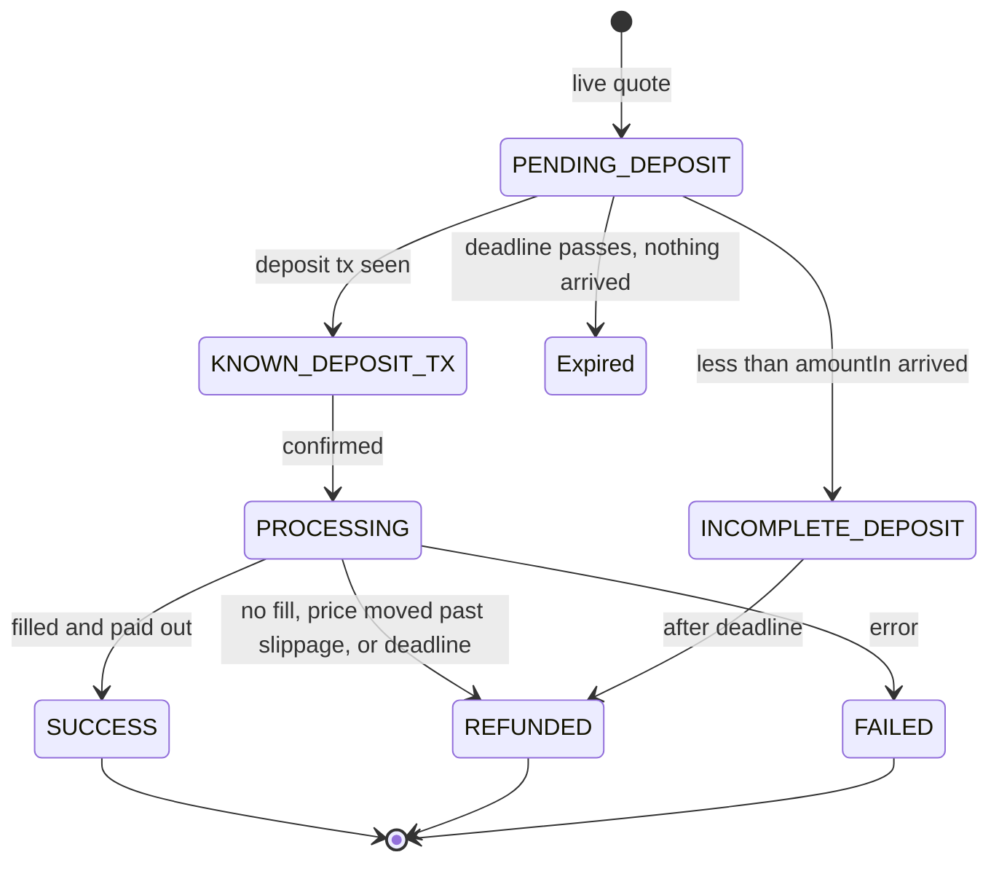

# NEAR Intents swaps

How the wallet swaps between QTC and another chain's token, in either direction, through the NEAR Intents 1Click API, who sends what, and who waits on whom.

The origin chain is where the deposit goes in: the other chain when swapping into QTC, Quantus when swapping out of it. The destination chain is where the payout lands.

Verified against the live API on 2026-09-20; the token list and a dry quote each way between QTC and USDC checked again on 2026-11-24. There is no testnet for NEAR Intents.

## What NEAR Intents is

An intent is a signed statement of an outcome: "I give X of asset A on chain P and want at least Y of asset B on chain Q." Solvers, which are market makers, compete to fill it. The fill settles on NEAR inside the Intents Verifier contract, and bridged representations of the assets (`nep141:*.omft.near`) move in and out over NEAR's bridges.

The 1Click API (`https://1click.chaindefuser.com`) is the REST front door to all of that. It runs the price auction, hands out one deposit address per quote, watches the origin chain, drives execution, pays out and refunds. The wallet only talks to 1Click, through our proxy at `https://oneclick.quantus.com` (`AppConstants.oneClickEndpoint`, the [one-click-proxy](https://github.com/Quantus-Network/one-click-proxy) Worker), which forwards every `/v0` call as it is and adds the partner key and the app fee. It never signs or holds any of the swapped funds.

## Actors

| Actor | Where it runs | What it does |
| --- | --- | --- |
| User | The Quantus wallet, plus their own wallet on the other chain (MetaMask, Phantom, a BTC wallet...) | Swapping in: types the amount and a refund address, then sends the deposit from the other wallet. Swapping out: types the amount and a recipient address, then confirms. |
| Quantus wallet | The app, `SwapService` in `quantus_sdk` | Asks 1Click for tokens, quotes and status. Swapping in, the account is the recipient. Swapping out, the account is the refund address and the app signs the QTC deposit itself. |
| 1Click API | NEAR Intents infrastructure | Auction, deposit addresses, chain watching, execution, payout, refunds, status. |
| Solvers | Off-chain market makers connected to 1Click | Price the quote and fill the intent. |
| Intents Verifier contract | NEAR | Settles the fill atomically. |
| Other chain | ETH, BTC, SOL, BASE... (38 chains besides Quantus on 2026-11-24) | The origin of a swap in, the destination of a swap out. |
| Quantus chain | Quantus | The destination of a swap in, the origin of a swap out. 1Click lists it under the chain code `qtc`. |

## The happy path: swapping into QTC



## The happy path: swapping out of QTC

The same quote and status calls with origin and destination swapped. The difference is the deposit: the wallet sends it, so the user never leaves the app.



The deposit is an ordinary signed transfer from the active account, so only transparent accounts whose key lives in the app can swap. Encrypted, Keystone and watch-only accounts see the swap button disabled.

## Who waits on whom

| Step | Who waits | On what | How long | What ends it |
| --- | --- | --- | --- | --- |
| Token list | App | 1Click | Under a second | Response. Cached for 2 minutes in the app; Try Again asks afresh. |
| Dry quote | App | 1Click, which waits on solvers | 1 to 5 s (`quoteWaitingTimeMs` is 3000) | Best solver price, or "Failed to get quote" if no solver bids. |
| Live quote | App | 1Click | Same as dry | Deposit address is reserved until `deadline`. |
| Deposit | 1Click, app polls | Swapping in: the user's transaction on the other chain. Swapping out: the app's QTC transfer, handed to 1Click with `/v0/deposit/submit`. | Up to the deadline: 20 minutes in our request, 2 hours from BTC, LTC, DOGE, BCH, DASH and ZEC, whose confirmations take longer than that | Deposit seen, or deadline passes. |
| Confirmation | 1Click | Origin-chain finality | Seconds on SOL, minutes on ETH, up to an hour on BTC. Docs say allow 15 min. | Enough confirmations. |
| Settlement | 1Click | Solver fill and NEAR finality | Seconds | Intent settled. |
| Payout | 1Click | Destination-chain withdrawal | Seconds to minutes | `SUCCESS` with `destinationChainTxHashes`. |

The app never blocks on anything but its own HTTP calls and, swapping out, the QTC transfer submission. The user waits on the progress screen, and it is safe for them to leave it: 1Click continues regardless, and the app keeps following the swap (see [Following several swaps](#following-several-swaps)). The one exception is a swap in on the phone whose deposit has not been sent yet, which leaving its deposit screen drops.

## Who sends what

| Call | App sends | App reads back |
| --- | --- | --- |
| `GET /v0/tokens` | nothing | `assetId`, `symbol`, `blockchain`, `decimals`, `price`. Tokens without a price are left out, and one listing is kept per symbol and chain, each symbol's main one first. The entry on the `qtc` chain is QTC as 1Click lists it, whatever its asset id, and takes over from the app's own QTC metadata; QTC's listings on other chains (NEAR and Solana on 2026-11-24) are left out. The remote config key `swapQuantusAssetId` names the entry instead when 1Click files it under another chain code or lists several assets on Quantus. A listing is refused if its decimals differ from the chain's or if it leaves more than one candidate for QTC, and one without a price does not count. Until QTC is listed with a price the swap screen shows "Swap disabled" instead of the form, and nothing more; when the token list cannot be loaded it shows "Swap unavailable" with a retry. |
| `POST /v0/quote` | `dry`, `swapType` (`EXACT_INPUT`, or `EXACT_OUTPUT` when the amount is typed on the side that receives), `slippageTolerance` (0.5, 1 or 2%, or one typed up to 99%; 100 basis points by default), `originAsset`, `destinationAsset`, `amount` in base units of the side it is typed on, `depositType: ORIGIN_CHAIN`, `depositMode` (`MEMO` for a Stellar origin, which 1Click refuses to quote otherwise, `SIMPLE` everywhere else), `refundTo` and `refundType: ORIGIN_CHAIN`, `recipient` and `recipientType: DESTINATION_CHAIN`, `deadline`, `quoteWaitingTimeMs: 3000`, `referral: quantus`. Every call goes through our proxy at `oneClickEndpoint`, which adds the partner key and the app fee (see Fees). | `quote.amountIn`, `amountOut`, `minAmountOut`, `amountInUsd`, `amountOutUsd`, `timeEstimate`, `deadline`, `depositAddress` (live only), `depositMemo` (chains such as Stellar need it on the deposit; the deposit screen shows it with its own copy action and a warning), `correlationId`, `signature`. Every quote's signature is checked before it is used (`OneClickQuoteSignature`, a port of `verifyQuoteSignature` from the 1Click TypeScript SDK: Ed25519 over the base58 SHA-256 of a key-sorted JSON of the signed request and quote fields plus `timestamp`, against `AppConstants.oneClickManagerPublicKey`), the echoed `quoteRequest` must repeat the amount, assets, addresses, slippage, `dry` flag and deadline that were sent, and `quote.amountIn` must be the amount sent, so the reviewed input is what a swap out transfers. A live quote whose deposit deadline is under `SwapService.minimumDepositLead` (5 minutes) away is refused before anything is sent. A token standing for QTC must be QTC as listed at that moment, so a sheet or review left open across a change of `swapQuantusAssetId` cannot quote or create a swap for the old asset. A confirmation whose live quote was still pending when the asset changed is dropped before anything is sent, and the deposit is submitted only if the asset is still the same once the user has authenticated. Any of these failing is a `SwapQuoteIntegrityException`. The signed response of every live quote is kept on the device (`SwapService.getSavedLiveQuotes`, last 50): 1Click settles a dispute about a deposit address from it. |
| `POST /v0/deposit/submit` | `txHash` of the QTC transfer, `depositAddress`, `memo` if any. Swapping out only. | nothing the app uses |
| `GET /v0/status` | `depositAddress`, `depositMemo` if the quote had one | `status`, `swapDetails.amountOut`, `refundedAmount`, `refundReason`, `originChainTxHashes[].hash`, `destinationChainTxHashes[].hash`. Every 1Click request is given 30 seconds (`OneClickService.requestTimeout`); a status request that times out is treated like any failed poll: the notice with Retry shows and the next poll is scheduled, while the late answer, if one comes, is dropped. |

Amounts are strings of base units in both directions. The wallet parses user input with the origin token's decimals and formats every amount with its own token's decimals.

Errors come back as `{"message": ...}` with a 4xx status. The app shows the message as is. Seen live: `refundTo is not valid`, `tokenOut is not valid`, `Failed to get quote` for an amount too small to fill, and 404 `Deposit address ... not found` on status.

## Swap status



`Expired` is not a 1Click status. 1Click keeps reporting `PENDING_DEPOSIT` after the deadline; the app shows an expired view when the deadline has passed and nothing arrived, and keeps polling in case a late deposit turns into a refund.

## Refunds

- Less than `amountIn` arrives: refunded to `refundTo` after the deadline, minus `refundFee` (0.30 USDC on ETH in the live probe).
- More than `amountIn` arrives: the swap executes and the excess goes to `refundTo`.
- No solver can fill, or the price moves past the slippage: `REFUNDED`.
- 1Click validates `refundTo` against the origin chain at quote time, so a bad refund address never reaches the deposit step.

## Fees

- Without a partner key 1Click adds its platform fee to every quote: 25 basis points per the docs, 20 in the live probes of 2026-09-26, echoed as `appFees: [{recipient: 5880ad2b..., fee: 20}]` on a request that sent none.
- With a partner key from partners.near-intents.org the platform fee is 20 basis points, 1 basis point on stablecoin and same-asset routes. The proxy at `oneClickEndpoint` adds the key; the app never holds it.
- The app's own fee is added by the proxy as `appFees`. The app sends none and does not check the echo, which the signature does not cover.
- Fees are inside `amountOut`. Nothing is charged on top of `amountIn`.
- `refundFee` and `withdrawFee` in the quote are in base units of the origin asset.

## Geo gate

NEAR Intents is not available in every country, so the swap button is only shown where it is. Quersi decides: it runs behind Cloudflare, reads the visitor's country from the `CF-IPCountry` header, checks it against the blocked countries and ranges in its hot-reloaded `geo_config.json`, and adds the verdict to the wallet config it already serves as `geoNearAllowed`. The app's `RemoteConfigModel.swapAvailable` is that verdict, and the home screen shows the swap card on that. The verdict is read from the remote config like every other flag: it defaults to allowed, the cached config carries the last answer, and it refreshes with the remote config, at launch and on every return to the foreground. The request is given 15 seconds, so one that hangs cannot block later refreshes, and an answer to a request that was still in flight when the app came back to the foreground is discarded while a fresh request follows. Every place a new swap can start or be confirmed checks it: the home card, the swap form (which shows "Swap disabled"), the review's confirm button and the "Start a New Swap" button after a failed swap. On the desktop those are Swap in the toolbar and the Account menu, the sheet (which shows "Swap disabled") and its Confirm, and Start a New Swap; the location is also asked again each time the window comes to the front and each time the Swap sheet opens. A confirmation already awaiting its live quote stops too, and one at the authentication prompt refreshes the location once the user has authenticated and sends only on a fresh allowance, since the prompt can hide a move elsewhere. A backgrounding during that prompt is kept from the unlock logic to avoid a double prompt, but the resume that follows still re-checks the location. The status of a swap already in flight stays reachable. `GET https://qrc-1.quantus.com/api/geo/near-allowed` shows what the gate saw for the caller. The block list itself lives in the quersi repo (`geo_config.example.json` and its README).

## Authentication

1Click has no accounts and no login. The token list, quotes, deposit submission and status are public endpoints, and every call this app makes goes out without credentials; the proxy adds the partner key. A swap's only authorization is its deposit address: whoever sends funds to it has swapped. The tester's own wallets (MetaMask, a NEAR wallet, an exchange withdrawal) hold and move the funds on the other chains; the app never signs anything there. There is no login to NEAR or NEAR Intents anywhere in the flow.

The one credential is a partner JWT from the Partner Dashboard at https://partners.near-intents.org/home, sent as `X-API-Key: <jwt>` (`Authorization: Bearer <jwt>` is also accepted); it identifies the integrator for volume attribution and fee sharing, and drops 1Click's platform fee from 25 to 20 basis points. The proxy at `oneClickEndpoint` adds it; the app never holds it.

## Preflight: testing the flow before QTC is listed

1Click has no testnet and no sandbox. `dry: true` only prices a quote and leaves out the deposit address and deadline, so it exercises nothing after the quote. Deposit, confirmation, settlement, payout and refund only happen with real funds; small amounts are the only way to test them.

A debug build can stand another listed asset in for QTC:

```bash
flutter run \
  --dart-define=SWAP_PREFLIGHT_ASSET=nep141:wrap.near \
  --dart-define=SWAP_PREFLIGHT_ADDRESS=tester.near
```

- `SWAP_PREFLIGHT_ASSET` is any asset id from `GET /v0/tokens`. The app treats it as QTC's side of the swap: it leaves the token picker, takes QTC's place on the form, and keeps its own symbol, network and decimals.
- `SWAP_PREFLIGHT_ADDRESS` is the tester's account on that asset's chain. It takes the place of the Quantus account as the recipient of a swap in and the refund address of a swap out.
- The form carries a banner naming the stand-in. Each app's `bootstrap()` refuses to start a non-debug build that has the flag set, or one that has the asset without the address, so no user can ever see this mode (the desktop through `checkSwapPreflightDefines`). `AppConstants` reads the flags and `SwapPreflight.fromEnvironment` (`wallet_core/lib/models/swap_preflight.dart`) turns them into the stand-in; `swapPreflightProvider` hands it to the screens, and tests override it.

What it covers, with USDC on Ethereum and wNEAR as the pair:

- Swap in (USDC → wNEAR): the whole real flow. Dry quote, live quote, deposit screen with address and QR, deposit from an external wallet, status polling, payout to `SWAP_PREFLIGHT_ADDRESS`, the expired and refunded paths. Nothing is simulated.
- Swap out (wNEAR → USDC): dry quote, review without the network fee and balance rows, live quote, then the deposit screen in place of the in-app transfer. The app cannot sign on NEAR, so the tester sends the deposit by hand from a NEAR wallet; `/v0/deposit/submit` is not called and 1Click finds the deposit on its own. The one step of a real swap out this leaves untested is the QTC transfer to the deposit address, which is the ordinary send path with the deposit address as recipient.

Amounts: 1Click answers `Failed to get quote` when no solver bids, which it does for amounts too small to be worth filling; 10 to 20 USD has worked in probes. The platform fee, the solver's spread and the origin chain's gas come out of each test. Any other listed asset works the same way as wNEAR, for example USDC on Base with the tester's Base address when that wallet is at hand; the stand-in only has to be on a chain the tester can send from and receive on.

## Where this lives in the wallet

| Screen or class | File | 1Click call |
| --- | --- | --- |
| `SwapScreen` | `mobile-app/lib/v2/screens/swap/swap_screen.dart` | Tokens on open. One form for both directions; the arrows flip it. Swapping out, the paying side shows the account's balance with a Max that types the most it can put in: the balance less the deposit's fee and the existential deposit (`swapMaxIn`), which is also what the form and the review hold the amount to. "Swap disabled" in place of the form until QTC is listed with a price; "Swap unavailable" with a retry when 1Click cannot be reached. |
| Address sheet | `mobile-app/lib/v2/screens/swap/swap_address_sheet.dart` | Recipient (out) or refund (in) address, kept on the form; the form quotes once it has both an amount and the address. Saved addresses are per network. |
| `ReviewSwapScreen` | `mobile-app/lib/v2/screens/swap/review_swap_screen.dart` | Confirm, through the shared `SwapConfirmation`: live quote, checked against the reviewed minimum. Swapping out, it also signs and sends the deposit and calls `/v0/deposit/submit`. A deposit that lands after the review was left is still followed, unless the wallet logged out meanwhile (`ActiveSwapsNotifier.ticket`). |
| `SwapProgressScreen` | `mobile-app/lib/v2/screens/swap/swap_progress_screen.dart` | One of the swaps kept on the device, by its deposit address, all polled in turn every 10 s through `activeSwapsProvider`: the deposit address while a swap in waits, then progress steps, complete, or failed and refunded. |
| `SwapActivityRows` | `mobile-app/lib/v2/screens/swap/swap_activity_row.dart` | One row per followed swap, pinned above the home activity, newest first: the amounts, the step, the dots and the clock. A settled swap keeps its row until it is opened. A swap whose deposit is still to be sent has none. |
| `ActiveSwapsNotifier` | `wallet_core/lib/providers/active_swaps_provider.dart` | The followed swaps, kept by `SettingsService` as a list keyed by deposit address and polled in one loop; deposit tickets that only a logout voids; at most ten at once. |
| `SwapConfirmation`, swap form and review rules | `wallet_core/lib/swap/` (`swap_confirmation.dart`, `swap_form.dart`, `swap_review.dart`, `swap_progress.dart`) | Shared by both apps: the live quote and the deposit on Confirm, the amounts, the request a form quotes, and the steps a swap shows. |
| Desktop `SwapSheet` | `desktop-app/lib/ui/swap/swap_sheet.dart` | The desktop's form and review in one sheet: tokens on open, a quote as the form rests, Confirm through `SwapConfirmation`. The limit of ten, the location and an unreachable 1Click are said in place of the form. |
| Desktop `SwapRowView`, `SwapDetail` | `desktop-app/lib/ui/swap/swap_row_view.dart`, `swap_detail.dart` | A followed swap's row in its account's In progress, and its panel at the window's right. |
| `SwapService` | `quantus_sdk/lib/src/services/swap_service.dart` | The HTTP client. `SwapApiException` carries the server message. |
| `SwapToken`, `SwapQuote`, `SwapOrder` | `quantus_sdk/lib/src/models/swap_*.dart` | Asset ids and BigInt base-unit amounts. |
| `SwapPreflight` | `wallet_core/lib/models/swap_preflight.dart` | The stand-in for QTC from the preflight dart-defines, null in real builds. |
| Endpoints | `quantus_sdk/lib/src/constants/app_constants.dart` | `oneClickEndpoint`. |

Tests: `quantus_sdk/test/services/swap_service_test.dart` covers the request shape, response parsing, every status, deposit submission, error handling, and signature checks against a mock HTTP client that signs its responses; the 1Click SDK's staging fixtures are verified byte for byte against its staging key. `mobile-app/test/screens/swap_flow_test.dart` drives the form, the swap-out confirmation, the price-moved re-confirmation and the outcome screens, plus the preflight stand-in: the tester address on QTC's side in both directions, and the deposit screen in place of the transfer for a swap out. `wallet_core/test/swap/` covers the shared confirmation and form rules, and `wallet_core/test/providers/active_swaps_provider_test.dart` the polling of several swaps and the limit. On the desktop, `desktop-app/test/ui/swap/swap_sheet_test.dart` drives the sheet and `swap_follow_test.dart` the rows and panels.

## Following several swaps

The wallet follows any number of swaps at once, up to ten. Each is an `ActiveSwap` told apart by its deposit address, with the memo appended where the chain needs one; 1Click never hands the same address out twice. `SettingsService` keeps them as a list under `active_swaps_v1`, in order of starting; the one swap an earlier version kept under `active_swap_v1` is moved into the list on the first launch after the update.

`ActiveSwapsNotifier` holds the list. One timer polls every swap that is neither settled nor simulated, in turn, every 10 s, and merges each answer into that swap as it is when the answer arrives, so "I've Sent It" survives a poll in flight and a swap put away meanwhile is left alone. The timer pauses while the app is in the background, except on Android, where the swap card's foreground service keeps polling, and it runs only while some swap is short of its deadline; an overdue swap is polled once at launch and once on each return to the foreground. A deposit ticket is taken as a confirmation begins and holds one of the ten slots until the swap starts on it or the confirmation gives up, so two confirmations in flight cannot overshoot the ten; only a logout voids a ticket, so a deposit that lands after the review was left is still followed, while starting or dismissing another swap no longer affects it. `swapClockProvider` ticks once a second while any swap runs; rows and screens take their elapsed time from it. The lock-screen card shows one swap (`swapOnCard`): the newest still with 1Click, else the one that settled last; a tap on it opens that swap. A finished swap's card stays up only while that swap's own progress screen is the one on top.

On home, the Swap button always opens the form, and `SwapActivityRows` pins the followed swaps above the activity, whether the feed has loaded, failed or is still loading: running and overdue ones with their step, settled ones as "Swap Complete" or "Swap Failed" until they are opened and put away by Done or back. A swap still waiting for its deposit to be sent is not pinned; leaving its deposit screen drops it, since funds sent to that address later are still swapped by 1Click and arrive on their own, and one still waiting at the next launch, its deposit screen gone with the last run, is dropped then for the same reason, whether or not its window has closed. The desktop app lists such a swap among the rest, so it keeps it across a restart (`keepsUnpaidSwapsProvider`). There, too, Swap always opens the form: each followed swap is a row of its own account's In progress, newest first, and opens in the panel at the window's right, and the sidebar counts an account's swaps until they are put away. A swap whose account the wallet no longer holds, as after that account was disconnected, is listed under whichever account is open, so it can still be opened and put away, and counts on every account's badge: a badge is the number of rows its account lists. With ten swaps running, the desktop's Swap sheet says so in place of the form (`swapsAtLimitProvider`), and the form takes its place again once one of them settles or is put away. Confirming is shared by both apps (`SwapConfirmation`, `wallet_core/lib/swap/swap_confirmation.dart`): it refuses an eleventh swap, confirmations under way counted, which is where the phone first says the limit. The debug harness seeds simulated swaps with deposit addresses of their own, so several can be walked at once, and clears them all.

## Limits

1. **Swaps are known only to this device.** The followed swaps are kept on the device and 1Click has no listing per account, so a swap put away, or one started elsewhere, cannot be shown again; a swap out's deposit shows as an ordinary transfer in the activity.
2. Only origin-chain deposits and destination-chain payout. Signed-intent execution would need the wallet to sign NEP-413 or similar payloads.
3. The slippage picked is not kept between launches.
4. If 1Click ever files QTC under a chain code other than `qtc`, the swap form says "Swap disabled"; if it lists several assets on Quantus and none of them is called QTC, it says "Swap unavailable". Either way, naming the asset id in the quersi `wallet_config.json` (hot reloaded by quersi, read by the app at launch and on every return to the foreground) puts it right, with no app update:

   ```json
   "swapQuantusAssetId": "nep141:qtc.omft.near"
   ```
